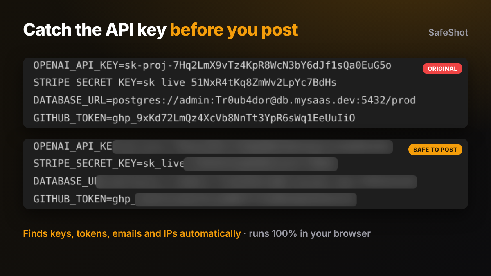

# SafeShot

**Catch the API key in your screenshot before the internet does.**

Drop a screenshot. SafeShot reads the text on it, finds API keys, tokens, emails, phone numbers and IP addresses, and blurs them. The image never leaves your browser.

**[Try it live](https://lockdomain.github.io/safeshot/)**



## Why

Every week someone posts a build in public screenshot with a live Stripe key, a database URL or a customer's email in it. Bots scrape X and GitHub for exactly this. SafeShot is a five second check before you hit post.

## What it detects

| Type | Examples |
| --- | --- |
| Known key formats | OpenAI `sk-`, Anthropic `sk-ant-`, Stripe `sk_live_` `pk_live_` `whsec_`, GitHub `ghp_` `github_pat_`, GitLab `glpat-`, AWS `AKIA`, Google `AIza`, Slack `xox`, SendGrid `SG.`, JWTs |
| Secrets in config | Any value after `API_KEY=`, `SECRET:`, `TOKEN=`, `PASSWORD=` and similar |
| Connection strings | `postgres://`, `mysql://`, `mongodb+srv://`, `redis://` |
| Random looking strings | 24+ characters with letters, digits and high entropy |
| Contact details | Emails, phone numbers |
| Infrastructure | IPv4 addresses, card numbers (Luhn checked) |

## How it works

1. The screenshot is upscaled 2x so small UI text reads well
2. [Tesseract.js](https://github.com/naptha/tesseract.js) (WebAssembly) finds every word and its position, locally
3. `detect.js` runs the rules above on each line and maps matches back to pixel boxes
4. For secrets the box is extended to cover the whole token, because OCR sometimes splits long strings
5. You choose blur, pixelate or a black bar, click any box to undo it, or drag to hide something else

OCR is not perfect. Always look at the result before you post.

## Run locally

```
git clone https://github.com/lockdomain/safeshot
cd safeshot
python3 -m http.server
```

Open http://localhost:8000. No build step, no dependencies to install. Tesseract loads from jsDelivr.

## License

MIT
